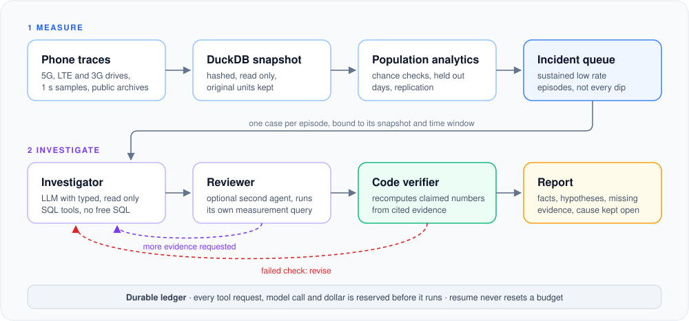
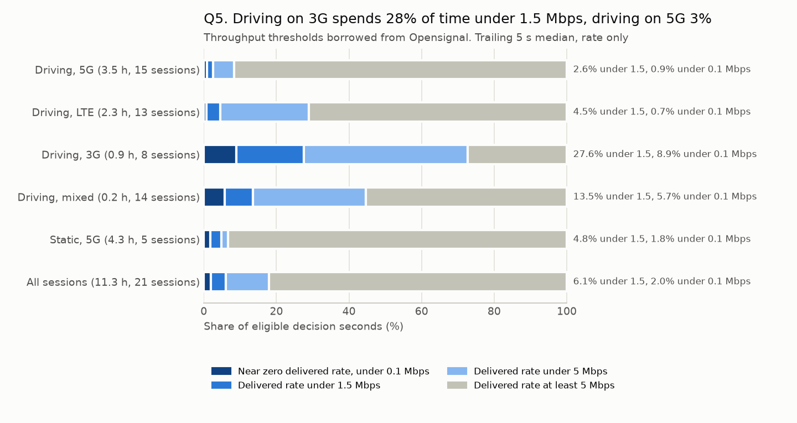
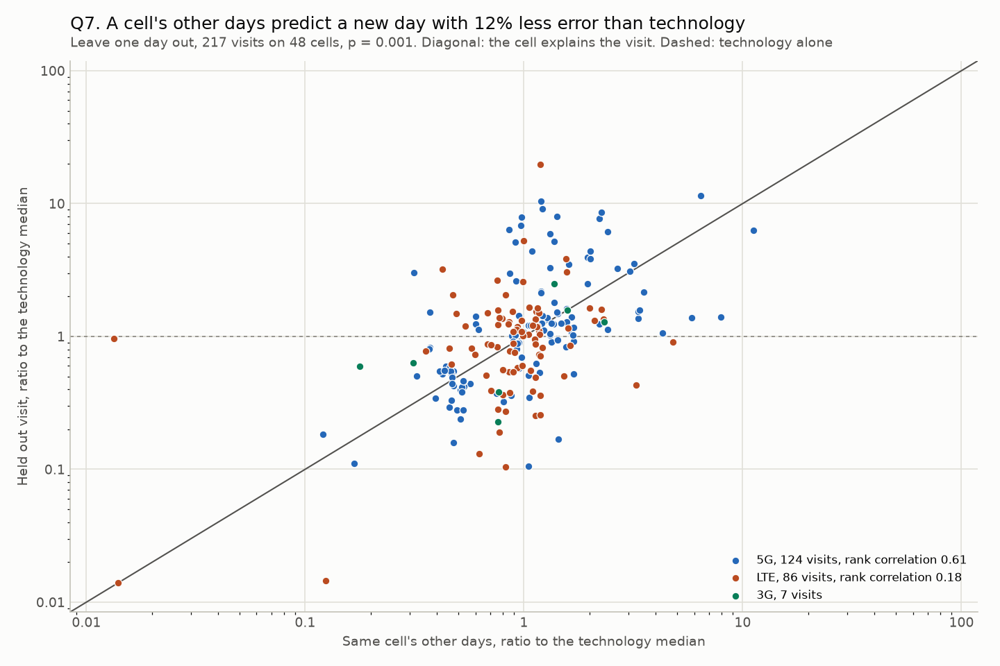
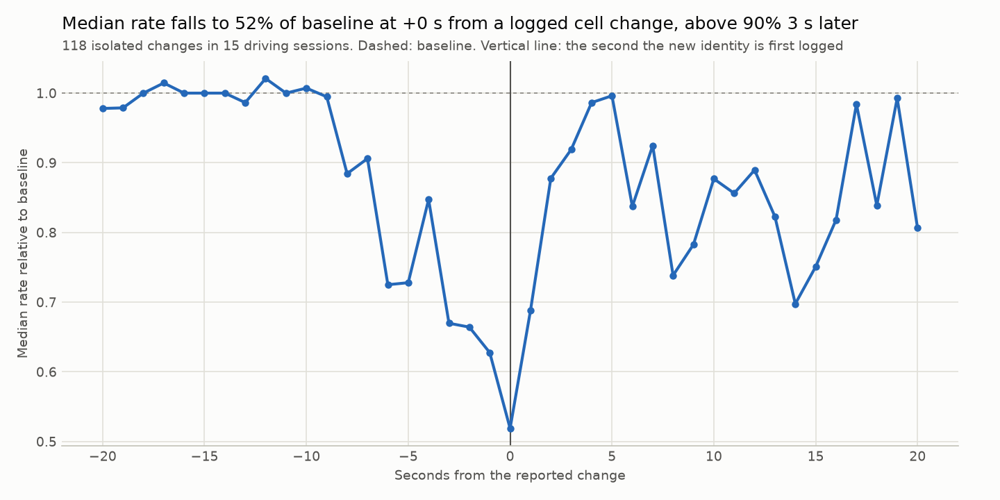
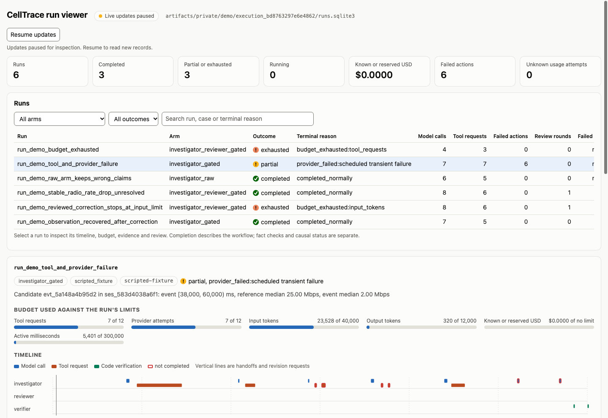
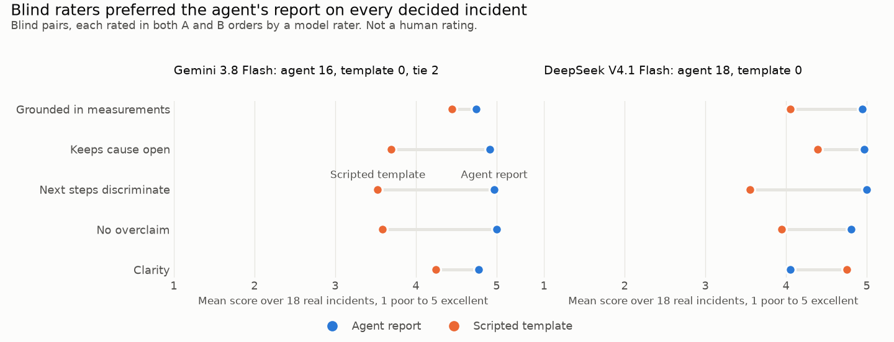

<div align="center">

# CellTrace

**Find where phones lose throughput, test whether the pattern is real, and let LLM agents investigate
each incident with structured numerical claims recomputed in code.**


</div>

<p align="center">
  
</p>

CellTrace turns phone side cellular traces into findings an engineer can act on. It loads drive
test archives into DuckDB, measures where and when the delivered rate is poor, and tests the
patterns against chance, checking the strongest on held out days and on a second dataset.
Sustained low rate incidents
then go to an LLM Investigator that can only query the data through typed SQL tools. Code
recomputes its structured numerical claims, and every model call and dollar is reserved in a
durable budget before it runs. The analytics, tests and offline demo run on a laptop.

## Results at a glance

| | |
| --- | --- |
| **Slow cells stay slow** | A cell's other days predict a new day's rate with 12% less error than its technology alone (p = 0.001). Replicated on the 2017 and 2018 LTE dataset: 36% and 21% for the two operators |
| **Drops start before the logged cell change** | In 61% of drops near a logged cell change the drop starts first (53% under shifted timing, p = 0.002). The rate falls to 52% of baseline and is back above 90% 3 s later |
| **Low rate comes in long stretches** | Half of all seconds under 1.5 Mbps sit in stretches of 10 s or more, twice what the rate's own autocorrelation produces (Holm p = 0.010). Driving on 3G spends the largest share of its time under 1.5 Mbps: 28%, against 3% on 5G |
| **Forecasts validated before they are trusted** | Gradient boosting cuts next 5 s rate error by 28% against persistence on unseen sessions, and an external test on US drives, run once, shows where it stops transferring |
| **Agents stay grounded** | 23 of 27 constructed cases pass on all three repeated trials, and none of the 81 runs uses a label its case forbids. All 18 real incidents ran live for USD 0.28: 16 completed, 2 reached the tool limit, and 290 claims were verified in code |
| **Blind model raters prefer the agent's reports** | Two model raters, blind to the source and checked on planted errors, preferred the agent's report over a scripted template in all 8 recording sessions (p = 0.008) |

## What the data shows



**Where users suffer.** Driving on 3G fares worst: 28% of its time is under 1.5 Mbps, against 3%
on 5G. The field audit also shows where data collection falls short: the detector can monitor 78
to 79% of download time, and 3G rows never report SNR or CQI, so radio rules cannot be assessed
there.



**Slow cells stay slow.** Each dot is one visit, a session passing a cell, on a held out day. Points along the diagonal mean
the cell's own history predicts the new day. After shrinkage for few visits, 2 of the 10 raw
slowest cells remain reliably twice as slow as their technology, among them an LTE cell with good
signal (−77 dBm) whose median rate was 0 Mbps on two days, a clear target for an engineer.



**Drops start before the logged cell change.** Around 118 isolated changes the rate sinks for
several seconds before the new cell is logged, consistent with degradation that triggers a
handover. Logging is once a second, so this is the order of logged events.

## Forecasting the next five seconds


A `HistGradientBoostingRegressor` forecasts the next 5 s mean rate from past only features, with
six configurations declared in advance and chosen inside each fold. Whole sessions are held out
(leave one session out and forward chaining), and 80% intervals are calibrated with conformal
prediction (80.0% coverage). The forecast cuts error by 28% against persistence and 26% against
the best simple baseline. Before trusting it beyond this data, it was applied unchanged to AT&T
traces from three US drives recorded with a different phone, with its decision rule fixed in
advance and run once. There
persistence won, so CellTrace keeps forecasts out of its decisions until they are validated on the
target data.

## How the agents work



*The run viewer on the offline demo.*

- **Typed tools only.** The Investigator queries the case's read only snapshot through
  parameterized SQL tools bound to one time window. No free SQL, shell or web.
- **Code checks structured numerical claims.** Each claim cites stored evidence and is recomputed. A
  failed check sends the claim back for revision, and no agent can waive it.
- **Causes stay open.** Reports separate observed facts, hypotheses and missing evidence, and name
  the measurement that would decide between the explanations.
- **Budgets that survive crashes.** Tool requests, model attempts and dollars are reserved in a
  SQLite ledger before they run. Resuming a run never resets a budget, and an uncertain paid call
  is never silently repeated.



**Are the agents useful?** The 18 real incidents were written up by the live agent and by a fixed
scripted template, then rendered in one neutral format with identity removed. Two model raters,
Gemini 3.8 Flash as the primary rater and DeepSeek V4.1 Flash, which also wrote the agent reports,
rated every pair in both A and B orders and caught all 6 planted overclaims mixed in as
calibration pairs. In the final round, after the packet's rendering was corrected, neither
preferred the template on any incident: the agent proposes next measurements that separate the explanations and avoids
overclaiming, while listing a median of 15 verified measurements against the template's 3.

## Design decisions

- **Agents never touch raw data.** Typed tools on a hashed, read only snapshot make every tool
  result reproducible and keep labels and other cases out of reach.
- **Numerical claims are verified.** Code recomputes structured claims from the snapshot within
  declared tolerances. Free text interpretations remain unverified and are labelled in reports.
- **A scripted template sets the bar.** It runs the same checks with no model, so the agent must
  beat it to earn its cost. It comes close on labels (21 against 23 of 27 cases) and falls behind
  on explanations.
- **The Reviewer is optional because it was measured.** On unseen sessions it added 29% cost and
  used up the shared tool budget in 8 of 27 runs without improving label recovery, while code
  checks catch numerical errors, so it is kept for causal and capacity overclaims.
- **Methods are checked before results.** New statistical methods passed planted negative and
  positive controls before touching real data, and the external forecast test ran once under a
  rule fixed in advance.

Details for every result are in the [technical report](docs/TECHNICAL_REPORT.md).

## Quick start

Requires Python 3.12 and [uv](https://docs.astral.sh/uv/).

```bash
git clone https://github.com/Aminembarek2/CellTrace.git && cd CellTrace
uv sync --locked --group dev
uv run celltrace demo --offline                     # agents, verification and budgets on a synthetic fixture
uv run pytest -m "not live and not external_data"   # offline test suite
uv run celltrace --help                             # every command
```

Or in a container without network:

```bash
docker build -t celltrace . && docker run --rm --network none celltrace
```

## Running on real data

Download the public Raca Irish 5G archive and build a snapshot:

```bash
mkdir -p data/raw/raca_5g
curl -L -o data/raw/raca_5g/5G-production-dataset.zip \
  https://raw.githubusercontent.com/uccmisl/5Gdataset/306d92eba81cb4f1195d8b8eba625666a02a10ec/5G-production-dataset.zip
cp configs/data_sources/raca_5g.json data/raw/raca_5g/SOURCE.json
uv run celltrace ingest --source raca --input data/raw/raca_5g --out data/processed
```

Then run the analyses on the snapshot it prints:

```bash
uv run celltrace population --snapshot data/processed/<snapshot> --out reports/population --private-out reports/private
uv run celltrace cells --snapshot data/processed/<snapshot> --label "Raca Irish 5G, driving" --out reports/cells
uv run celltrace predict cross-validate --help
```

Live agent runs need an OpenRouter API key in `.env` (see `.env.example`), fresh
`provider-check` and `doctor --live` records, and an explicit `--live` flag (see
`uv run celltrace investigate-queue --help`).

## Project structure

```
src/celltrace/
├── data/          archive audit, ingestion and DuckDB snapshots
├── analysis/      population analytics, chance checks, cells, persistence, detector
├── prediction/    features, gradient boosting, cross validation, external validation
├── tools/         typed SQL tools exposed to the agents
├── agents/        Investigator and Reviewer roles and prompts
├── contracts/     typed claims, evidence, findings and reports
├── verification/  recomputation of structured numerical claims
├── workflow/      LangGraph graph, execution, recovery and the offline demo
├── reporting/     Markdown reports, run viewer and trace export
├── evaluation/    case construction, benchmarks, scoring, planted errors
├── providers/     OpenRouter adapter and the offline scripted adapter
└── storage/       SQLite run and evidence ledger
tests/             unit and integration tests
scripts/           study scripts and the quality workflow used by CI
results/           reports and figures behind every number in this README
docs/              technical report
```

## Documentation

- [Technical report](docs/TECHNICAL_REPORT.md): architecture, data, methods, every result and how
  it was checked, design decisions and reproduction
- [Results](results/README.md): the reports and figures behind each number

## Data and license

The code is MIT licensed. The datasets keep their own terms and are not redistributed: the Raca
Irish 5G dataset (D. Raca, D. Leahy, C. J. Sreenan and J. J. Quinlan, ACM MMSys 2020), the Raca
4G LTE dataset (ACM MMSys 2018) from the same laboratory and the PAM 2025 multi carrier dataset. See
[THIRD_PARTY_NOTICES.md](THIRD_PARTY_NOTICES.md).
