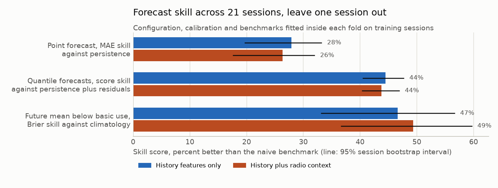

# CellTrace technical report

This report explains how CellTrace works, what it found and how each result was checked. The
[README](../README.md) gives the short version. Every number here comes from a file in
[`results/`](../results/README.md). The analytics can be regenerated from the public data with the
commands in the last section. Agent results come from paid live runs, whose aggregates are
published while their ledgers stay private.

## Contents

1. [System overview](#1-system-overview)
2. [Data](#2-data)
3. [Population analytics](#3-population-analytics)
4. [Low rate persistence](#4-low-rate-persistence)
5. [Drops and cell changes](#5-drops-and-cell-changes)
6. [Slow cells across days](#6-slow-cells-across-days)
7. [Forecasting](#7-forecasting)
8. [Investigation agents](#8-investigation-agents)
9. [Agent evaluation](#9-agent-evaluation)
10. [Design decisions](#10-design-decisions)
11. [Reproducing the results](#11-reproducing-the-results)
12. [Appendix: what was fixed in advance](#appendix-what-was-fixed-in-advance)

## 1. System overview


CellTrace has two halves that share one immutable data snapshot.

**Measure.** Raw phone traces are audited and ingested into a DuckDB snapshot identified by a
content hash. Population analytics then answer where and when the delivered rate is poor and test
the patterns against chance. The strongest pattern, slow cells, is also checked on held out days
and replicated on a second dataset. The analytics select the incidents worth investigating:
sustained low rate episodes rather than every short dip.

**Investigate.** Each incident becomes a case bound to its snapshot and time window. An LLM
Investigator gathers evidence through typed SQL tools. An optional Reviewer with its own context
checks the findings with its own measurements, and a code verifier then recomputes the structured
numerical claims. The report separates observed facts, hypotheses and missing evidence. Every
tool request, model call and dollar is reserved in a durable SQLite ledger before it runs.

| Layer | Implementation |
| --- | --- |
| Storage | DuckDB snapshots for measurements, SQLite for runs, evidence and usage |
| Analytics | pandas, NumPy, exact and permutation tests, session bootstrap |
| Forecasting | scikit-learn `HistGradientBoostingRegressor`, conformal intervals |
| Agents | LangGraph state graph, OpenRouter chat completions with native tools |
| Interfaces | `celltrace` command line, Markdown and JSON reports, HTML run viewer |
| Packaging | `uv` lock file, Docker image that runs without network |

## 2. Data

| Dataset | Use | Content |
| --- | --- | --- |
| Raca Irish 5G production dataset (University College Cork, ACM MMSys 2020) | Main analysis and agent cases | 21 file download sessions (16 driving, 5 static), about 12 hours of one second samples of which 11.3 hours are eligible for analysis, 5G, LTE and 3G, December 2019 to February 2020 |
| Raca 4G LTE dataset (same laboratory, ACM MMSys 2018) | Independent replication of the cell study | Static, pedestrian, car, bus and train traces, November 2017 to February 2018, two anonymised operators. The replication uses the car traces |
| PAM 2025 multi carrier dataset | Frozen external forecast test | AT&T downlink traces from three drives across the United States, recorded with a different phone and tool |

**Ingestion.** Samples are aligned to one second bins with half open millisecond bounds. A gap
longer than 3 s starts a new segment, missing values stay missing, and nothing is forward filled.
Original metric names and units are kept beside the canonical ones, and each snapshot records
the hashes of the files it was built from.

**Field audit.** Before any analysis, every column was audited per technology. The relative drop
detector can monitor 78 to 79% of download time, and most of the rest is one second bins without
samples. 3G rows never report SNR or CQI, and reported RSRP is treated as undefined on 3G, so radio
rules cannot be assessed there. The agents name these gaps as missing evidence in their reports.

## 3. Population analytics

[Report and figures](../results/population/population_report.md)

**Service levels.** Time under three delivered rate levels was measured per mobility and
technology, using a trailing 5 s median. 1.5 and 5 Mbps are the download components of the Core
and Excellent levels of the Consistent Quality metric used by Tutela and Opensignal, which also
uses latency, jitter and loss. 0.1 Mbps is a project level for near zero delivery.


Driving on 3G spends 28% (session bootstrap interval 19 to 36) of eligible time under 1.5 Mbps,
driving on 5G 3% (2 to 4). Intervals resample whole sessions and are reported only when eight or
more sessions support them.

**Drop detector and triage.** A relative drop detector compares a short event window with its
reference window. On this archive it fires about every 27 s (1319 drop events), and less often on
real data than on shuffled data (132 against 185 per hour), because real throughput is
autocorrelated. Its flagged decisions are 4.3 times as common inside sustained low rate as outside
(chance placement p = 0.001), yet 96% of its drop events fall outside it. The investigation queue
therefore starts from sustained low rate episodes: 19 episodes of 10 s or more under 1.5 Mbps
overlap a drop that no simple rule explains, and they map to 18 distinct incidents.

## 4. Low rate persistence

[Report](../results/persistence_and_order/persistence_and_order.md)

The question: are low rate seconds clustered into long stretches, beyond what the rate's own
autocorrelation produces? The null keeps each segment's values and autocorrelation: IAAFT
surrogates (Schreiber and Schmitz 1996, 2000) are computed on rank Gaussian scores, as in the
amplitude adjusted surrogates of Theiler et al. (1992), and mapped back by rank, within segment
and activity state.

This combination is the project's own, so it was validated before it touched the archive: on
fresh synthetic seeds it rejected 1 of 20 linear negative controls at each of two autocorrelation
levels and found all 20 planted positive controls.

**Result.** 52% of seconds under 1.5 Mbps sit in stretches of 10 s or more, against 25% in the
surrogates (199 surrogates, Holm adjusted p = 0.010). Low rate comes in stretches, which is what
makes episode level investigation worthwhile.

## 5. Drops and cell changes

[Report](../results/persistence_and_order/persistence_and_order.md)

**Association.** Flagged windows are 2.1 times as common when a logged serving cell change
occurs in the 10 s before confirmation, against 1.38 to 1.71 when the exposure is shifted in
time within eligible runs (Holm p = 0.005).

**Order.** In 337 drops with a logged change within 10 s, the drop starts before the logged
change in 61%, against 53% under shifted timing (p = 0.002). The median lag is 1 s.


Around 118 isolated changes in 15 driving sessions, the median rate falls to 52% of its baseline
at the change and is back above 90% 3 s later. The rate sinks first and the new cell is logged
after, consistent with degradation that triggers a handover. Logging is once a second and a
logged identity marks when the phone reported the change, so this is the order of logged events
and the analysis treats the change as a transition proxy.

## 6. Slow cells across days

[Irish archive](../results/cells/raca_2019_2020/cell_study_report.md),
[LTE operator A](../results/cells/lte_2018_operator_a/cell_study_report.md),
[LTE operator B](../results/cells/lte_2018_operator_b/cell_study_report.md)

**Question.** Does knowing the serving cell predict a new day's rate better than knowing only the
technology? A visit is one session passing one cell with at least 10 samples. Each day is held
out in turn, and the rate of each of its visits is predicted from the same cell's visits on other
days, both measured relative to the technology median.


| Dataset | Visits, cells | Error, same cell | Error, technology only | Skill | Test |
| --- | --- | ---: | ---: | ---: | --- |
| Irish 5G archive, driving | 217 visits, 48 cells | 0.285 | 0.325 | 12% | cell labels permuted, p = 0.001 |
| LTE dataset, operator A, car | 349 visits, 42 cells | 0.270 | 0.424 | 36% | p = 0.001, Holm 0.002 |
| LTE dataset, operator B, car | 132 visits, 29 cells | 0.162 | 0.204 | 21% | p = 0.001, Holm 0.002 |

Errors are mean absolute errors of log10 rate. The LTE dataset identifies cells by technology,
site coordinates and local number, a proxy for the serving cell. Its protocol was written down
before any per cell rate was computed and before the data was downloaded, and its power was
checked first: 98.6% for [operator A](../results/cells/lte_2018_operator_a/power_check.json) and
77% for [operator B](../results/cells/lte_2018_operator_b/power_check.json). Every
held out day of the LTE dataset showed positive skill. On the Irish archive skill was positive on
the December and January days and negative on the three February days (−4.7 to −10.1%), so slow
cell lists are best refreshed over time.

**Ranking slow cells.** Raw rankings favour cells with few visits. Cells are therefore selected by
posterior tail probability under a 10% marginal false discovery limit, adapting Gu and Koenker
(2023) to a fixed threshold of twice as slow as the technology. Of the 10 raw slowest cells, 2
remain selected, among them an LTE cell with good signal (−77 dBm) whose median rate was 0 Mbps on
two December days. The selection keeps its false discovery limit under
[three prior shapes](../results/cells/raca_2019_2020/prior_robustness.json).

## 7. Forecasting

[Cross validation](../results/forecasting/cross_validation/cross_validation_report.md),
[external validation](../results/forecasting/external_validation/external_validation_report.md)

**Task.** Forecast the mean delivered rate over the next 5 s from past only features: recent rate
history, and optionally context (reported RSRP, RSRQ, SNR and CQI, speed, uplink rate, activity,
cell changes and network mode).

**Model and selection.** `HistGradientBoostingRegressor` with `random_state=42` and no internal
early stopping, so no random validation split leaks across time. Six configurations were declared
before the nested cross validation. Inside each outer fold, five inner folds of whole training
sessions choose one, supply out of fold residuals for interval calibration and fit the
probability calibrator. The grid and features were developed earlier on this archive, so the
cross validation is a careful internal estimate and the external test is the independent check.

**Validation.** Two outer schemes keep every session whole: leave one session out (21 folds) and
forward chaining, which trains only on sessions that ended before each test session started.

| Forecast, leave one session out | MAE (Mbps) | Skill against persistence | Sessions better than persistence |
| --- | ---: | --- | ---: |
| Persistence | 27.07 | 0% | |
| Trailing mean | 26.96 | 0.4% | 12 of 21 |
| Gradient boosting, history features | 19.51 | 27.9% (19.7 to 33.2) | 14 of 21 |
| Gradient boosting, history and context | 19.94 | 26.3% (17.6 to 32.0) | 16 of 21 |

Forward chaining gives 30.5% skill. Against the strongest simple baseline, a weighted recent mean,
the history model is [26% better](../results/forecasting/cross_validation/simple_baselines.json).
Quantile forecasts improve the quantile score by 44.5% over persistence plus residual quantiles,
and conformalized quantile regression (Romano, Patterson and Candès 2019) brings 80% intervals to
80.0% coverage.



**External test.** The history model was then applied unchanged to AT&T downlink traces from
three drives in the PAM 2025 dataset (drive 1 and the first day of drives 2 and 3), recorded with
a different phone and tool. The protocol and decision rule were fixed before any PAM outcome was
used, and the test ran once. There persistence was more accurate, and the 80% intervals covered
48%. CellTrace therefore keeps forecasts out of its decisions until they are validated on the
target data, and persistence remains the default outside it.

## 8. Investigation agents

**Graph.** A LangGraph state graph runs the Investigator, the optional Reviewer, the code verifier
and the report renderer. Submitted findings go to the Reviewer when it is enabled, then to the
verifier. A failed verification or a Reviewer request for more evidence sends the findings back to
the Investigator, within fixed revision and review limits. Roles keep separate prompts and
conversations.

**Tools.** Agents see only typed, parameterized tools over the case's read only snapshot, limited
to the case window: `get_session_context`, `summarize_window`, `compare_windows`,
`get_activity_state`, `get_cell_transitions`, `get_metric_definition` and `get_evidence`.
Findings and reviews are submitted through `submit_findings` and `submit_review` and validated
locally against strict typed models. There is no free SQL, shell, file or web access, and no tool
can see labels, other cases or the evaluation manifest.

**Claims and verification.** Numerical claims are structured (metric statistic, metric change,
activity share, availability, transition) and cite evidence identifiers from the same snapshot. Code
recomputes each value from the snapshot and rejects claims outside the supported window, units
that do not match, or metrics that are undefined for the technology. No agent can waive a failed
check. Values pass within an absolute tolerance of 1e-6 plus a relative tolerance of 1e-4 in
canonical units. Free text commentary remains unverified and is labelled separately in reports.
The physical cause stays `unresolved`, because phone traces show symptoms, not causes.

**Budgets and recovery.** Tool requests, model attempts, tokens and dollars are reserved in the
SQLite ledger before each action and settled from the provider's reported usage, and active time
is checked against its limit. Resuming a run never resets a budget, an uncertain paid call is
never repeated automatically, and LangGraph checkpoints let an interrupted run continue from its
last state.

**Model.** All live agent runs used `deepseek/deepseek-v4.1-flash` through OpenRouter with a fixed
provider, no fallback routes and high reasoning effort. Endpoint capabilities and prices are
verified within a day before any paid call, and admission uses the highest advertised price.


The run viewer, shown here on the offline demo, reads a run store and shows each run's outcome,
budgets used against each limit and a timeline of model calls, tool requests and verification.

## 9. Agent evaluation

**Constructed cases.** Real windows are given known properties by construction: clean controls,
idle traffic, missing metrics, tool failures, misleading strings, stable radio rate drops, radio
changes and cell changes. Labels stay private and are scored in code. Prompts, tools, detector
settings and grading are frozen before held out cases are opened.

| Study | Result | Evidence |
| --- | --- | --- |
| Unseen sessions: 27 cases built from three sessions no earlier case used, first run | 0 of 24 runs carry a false drop label. Radio labels were not yet checked in code, and 5 of 8 completed stable radio runs reported radio degradation | [scores](../results/agents/unseen_sessions/score.json) |
| Repeatability: the same 27 cases rerun with later prompts, three isolated trials | 23 of 27 pass every trial (exact interval 66 to 96%), and none of the 81 runs uses a label its case forbids, USD 1.41 | [repeatability](../results/agents/repeatability/repeatability.json) |
| Scripted template on the same 27 cases | Template 21, agent 23 on all trials (exact McNemar p = 0.63). The template fails all idle traffic cases and delivers about 3 checkable claims per run against 13 | [comparison](../results/agents/template_baseline/comparison.json) |
| Planted errors for the Reviewer, two studies | Located in every draw, per distinct finding: physical cause asserted 12 of 12, rate presented as capacity 10 of 12, whole session overreach 4 of 12, so code now rejects an explicit whole session scope | [per finding](../results/agents/planted_errors/planted_finding_level.json) |
| Real incident queue | All 18 incidents ran live: 16 completed with 232 claims verified in code, and 2 reached the shared tool limit and closed with code assembled reports (58 verified claims), USD 0.28 | [report](../results/agents/incident_queue/live_queue_report.md) |

The three cases that fail every trial are radio cases on a single 3G window, where reported RSRP
is undefined and the required radio label cannot be supported. The agent reports the rate drop
and states that no usable radio measurement exists.

**Real incidents.** Thirteen of the 18 queued incidents come from three sessions recorded as
static on one 5G cell. In the 11 of those that completed, median reported RSRP moved by at most
1 dB while the rate fell, and the reports kept radio degradation open (SNR fell 6 and 8 dB in two
cases), ruled out mobility in 4 and named cell load, transport timing and NR radio quality as the
measurements that would separate the explanations.

**Blind rating.** [Summary](../results/agents/blind_rating/summary.json)


The 18 incidents were written up by the live agent and by the scripted template, then rendered in
one neutral format with model, cost and identity removed. Two model raters, Gemini 3.8 Flash on
Google AI Studio as the primary rater and DeepSeek V4.1 Flash, scored every pair on five criteria
from 1 to 5 and gave a preference. Each pair was rated twice in separate conversations, as
presented and with A and B swapped, because model raters favour one position (Zheng et al. 2023).
A preference counts only when both orders agree. Six calibration pairs carried a planted causal or
capacity overclaim, and a rater qualified only by catching at least 5 of them. Both caught all 6.

| | Gemini 3.8 Flash | DeepSeek V4.1 Flash |
| --- | ---: | ---: |
| Agent preferred, template preferred, tie | 16, 0, 2 | 18, 0, 0 |
| Grounded in measurements, agent minus template | +0.31 | +0.89 |
| Keeps the cause open | +1.22 | +0.58 |
| Next measurements discriminate | +1.44 | +1.44 |
| No overclaim | +1.42 | +0.86 |
| Clarity | +0.53 | −0.69 |

The 18 incidents come from 8 recording sessions. Counting each session once, both raters preferred
the agent in all 8 (exact sign test p = 0.008). The largest gaps are in proposing next
measurements that separate explanations and in avoiding overclaims: the template rules out
application demand from an active download flag alone, while the agent keeps that explanation
open. DeepSeek scores the shorter template clearer. Gemini's two ties are the two incidents whose
agent runs reached the tool limit and closed with code assembled reports. Agent reports are about
3.6 times longer than template reports, which a reader may also notice.

The planned second rater, GLM 5.3 Flash on DeepInfra, returned HTTP 429 on all 12 attempts and was
replaced by DeepSeek before any rating was read. Because DeepSeek also wrote the agent reports and
model raters can favour their own output (Zheng et al. 2023), Gemini is the primary rater. After
the first round (17 preferences for the agent, 1 tie, for both raters) was unblinded, the packet
turned out to hide which measurement each verdict rested on, which made the template look less
grounded than it is. The renderer was fixed for both sources, the packet rebuilt with a fresh key
and the rating repeated. The table above is the repeated round, and the preference held. Both
rounds together cost USD 1.11 for 192 ratings.

## 10. Design decisions

| Decision | Reason |
| --- | --- |
| Agents reach data only through typed tools on a read only snapshot | Every tool result is reproducible from the snapshot hash, and an agent cannot run arbitrary SQL or read labels |
| Code verifies structured numerical claims, and no agent can waive it | Recomputation checks values against the snapshot within declared tolerances, and free text remains unverified |
| Cause stays unresolved | Phone traces carry no cell load, scheduling or transport counters, so they show symptoms. Reports name the measurement that would decide instead |
| Investigator plus code checks is the default, the Reviewer optional | On the unseen sessions the Reviewer added 29% cost, used up the shared tool budget in 8 of 27 runs and did not improve label recovery, while code checks catch numerical errors. It is kept for the causal and capacity overclaims it catches best |
| A scripted template is the baseline | It runs the same checks without a model, so it is the bar the agent must clear to earn its cost |
| One fixed, low cost model for all agent runs | Comparisons stay on the same model and budget, under 2 cents per incident |
| Episodes, not drops, start investigations | The relative detector fires every 27 s, and 96% of its drop events fall outside sustained low rate |
| Forecasts drive no decision until validated on the target data | The external test showed persistence is safer outside the training data |
| Methods checked before results | New statistical methods passed planted negative and positive controls before touching real data. The appendix lists what was fixed in advance |
| Budgets reserved before every action | Retries and uncertain calls retain their charges against the same durable admission allowance |

## 11. Reproducing the results

```bash
uv sync --locked --group dev
uv run celltrace demo --offline                  # agents, verification and budgets on a fixture
uv run pytest -m "not live and not external_data"
```

Real data. Download the Raca archive into `data/raw/raca_5g/` (see the README), then:

```bash
uv run celltrace audit --input data/raw/raca_5g --out reports/audit
uv run celltrace ingest --source raca --input data/raw/raca_5g --out data/processed
uv run celltrace population --snapshot data/processed/<snapshot> --out reports/population --private-out reports/private
uv run celltrace cells --snapshot data/processed/<snapshot> --label "Raca Irish 5G, driving" --out reports/cells
uv run celltrace predict cross-validate --snapshot data/processed/<snapshot> --out reports/forecasting --private-out reports/private/forecasting
uv run celltrace investigate-queue --queue reports/private/investigation_queue.json --snapshot data/processed/<snapshot> --config configs/project-defaults.yaml --out reports/private/incidents --offline
```

Replace `<snapshot>` with the directory printed by ingestion. The queue command uses the file
generated by `population` above and creates a new scripted run with the public default
allowances. Its completion counts can differ from the historical matched baseline, which used
a frozen private configuration. Scripted runs demonstrate orchestration, not live model behavior.

The LTE dataset is ingested with `--source raca_lte_2018 --operator A` or `B`, and its cell study
adds `--mobility car --accept-proxy-identity`. Studies that ran as scripts:

| Script | Study |
| --- | --- |
| `scripts/strengthen_population_tests.py` | Low rate persistence and drop and cell change order |
| `scripts/cell_replication_power.py` | Power check before the LTE replication |
| `scripts/agent_repeatability.py` | Repeated trial statistics |
| `scripts/planted_finding_level.py` | Planted error results per distinct finding, with exact intervals |
| `scripts/blind_review.py` | Blind packet, automated rating, scoring and figure |
| `scripts/check_forecast_reproduction.py` | Refit check of saved forecast folds |
| `scripts/run_quality_workflow.py` | Lint, format, types, tests, demo, run viewer and trace export, as in CI |

**Reproducibility.** `celltrace release-manifest` hashes the source tree, snapshot, trained models,
splits and raw archive, and `celltrace reproduce` refuses any changed input, then rebuilds the
audit, exploration, detector candidates, forecast evaluation and demo from that manifest. Live
agent runs need an OpenRouter key, fresh `provider-check` and `doctor --live` records, and an
explicit `--live` flag, and every paid call is recorded in the run ledger. The public repository
contains aggregate historical agent results, but not their private frozen case manifests,
configurations, report packets or run ledgers. Scripts that recount those studies require those
local inputs, and the public commands above create new runs.

**Data terms.** The datasets keep their own licenses and are not redistributed. Please cite D.
Raca, D. Leahy, C. J. Sreenan and J. J. Quinlan, "Beyond Throughput, The Next Generation: A 5G
Dataset with Channel and Context Metrics", ACM MMSys 2020, D. Raca, J. J. Quinlan, A. H. Zahran
and C. J. Sreenan, "Beyond Throughput: a 4G LTE Dataset with Channel and Context Metrics", ACM
MMSys 2018, and the PAM 2025 multi carrier dataset paper when using the data.

## Appendix: what was fixed in advance

Each deciding test below was written in an internal plan before its result existed. The plans are
not published. Two result files also record the plan's SHA-256 hash.

| Fixed before the result | Plan hash in the result file |
| --- | --- |
| The LTE cell replication protocol, before any per cell rate and before the data was downloaded | No |
| The persistence surrogate test, its negative and positive controls and its decision rule | No |
| The order test of drops and logged cell changes | No |
| The external forecast test and its decision rule, run once | Yes, `results/forecasting/external_validation/external_validation_summary.json` |
| The blind rating protocol, raters, swap rule and qualification rule | Yes, `results/agents/blind_rating/summary.json` |

Added or changed after an earlier look at the data:

- The chance check null design for the population analysis was repaired after an earlier run on
  the same archive. The repaired design is the one reported.
- The first persistence surrogate method, plain IAAFT on raw rates, failed its own negative
  control (9 of 20 false rejections). It was replaced before any archive statistic was computed.
- The forecasting grid and features were developed on this archive before the nested cross
  validation, and the comparison with a weighted recent mean was computed afterwards from the
  saved predictions.
- The blind rating's repeated round was planned after the first round was unblinded, as described
  in section 9.
