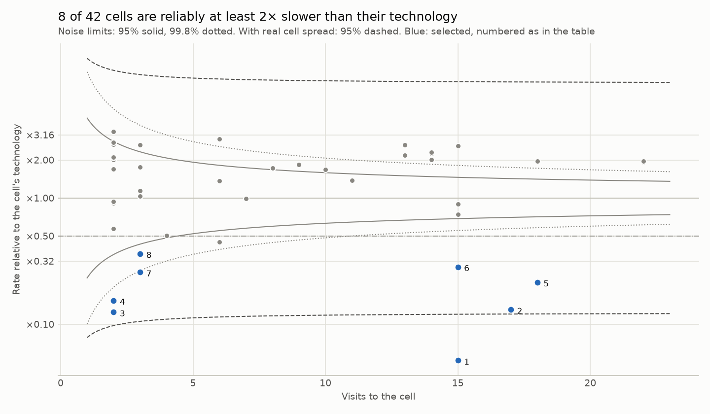
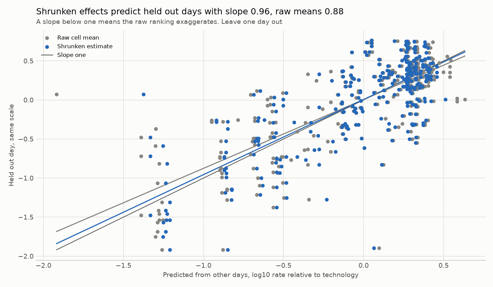

# Cell study: Raca Irish LTE dataset 2017 and 2018, operator A, car

Snapshot `snap_9d72a393002cef75`, file_download sessions, mobility car. Cell identity: proxy: technology family, site coordinates and local number. Method `cell_study_v1`, protocol `docs/TECHNICAL_REPORT.md`. Rates are delivered application rates, not capacity, and no cause is assessed.

## Does a cell keep its rate across days?

472 visits on 156 cells from 40 sessions over 11 days. 349 visits on 42 cells meet the same cell on another day. Leave one day out errors on log10 rate: same cell 0.270, same technology 0.424. Skill against technology 36.3%, permutation null mean -10.2%, p = 0.001. Decision by the frozen rule: replicates beyond technology.

Skill by held out day: 2017-12-04 59.9% (18 visits), 2017-12-05 55.0% (30 visits), 2017-12-06 29.2% (45 visits), 2017-12-07 46.5% (47 visits), 2017-12-08 22.8% (34 visits), 2017-12-09 5.6% (31 visits), 2017-12-11 35.9% (49 visits), 2018-01-16 49.7% (20 visits), 2018-01-17 25.0% (11 visits), 2018-01-18 34.5% (59 visits), 2018-01-19 47.6% (5 visits). The same cell beats its technology on 11 of 11 held out days.

Sensitivity: leaving one session out instead of one day gives 38.6% (p = 0.001), and requiring 20 samples per visit gives 35.5% (p = 0.001).

## Which cells are reliably slow for their technology?

42 cells seen on two or more days. A cell effect is the mean of its visits' log10 rate minus their technology mean. Within cell variance 0.1044, between cell variance 0.2138. Mean reliability 0.90, and 0.0% of cells fall below 0.7. 8 cells are selected as at least 2× slower than their technology at a 10% false discovery limit (expected false selections 0.51). The nonparametric prior selects 9.

| Cell | Technology | Days | Visits | Raw rate factor | Reliability | Shrunken factor | Probability at least 2× slower | Rank, 90% interval | Selected |
| --- | --- | ---: | ---: | ---: | ---: | ---: | ---: | --- | --- |
| LTE:-8.472919,51.895211:1 | LTE | 9 | 15 | ×0.05 | 0.97 | ×0.06 | 1.00 | 1 to 1 | yes |
| LTE:-8.477444,51.904307:2 | LTE | 9 | 17 | ×0.13 | 0.97 | ×0.14 | 1.00 | 2 to 4 | yes |
| LTE:-8.318107,52.416404:8 | LTE | 2 | 2 | ×0.12 | 0.80 | ×0.19 | 0.98 | 2 to 8 | yes |
| LTE:-8.480412,51.904804:6 | LTE | 2 | 2 | ×0.15 | 0.80 | ×0.22 | 0.96 | 2 to 9 | yes |
| LTE:-8.491719,51.893905:2 | LTE | 10 | 18 | ×0.21 | 0.97 | ×0.22 | 1.00 | 3 to 7 | yes |
| LTE:-8.610208,51.892332:2 | LTE | 9 | 15 | ×0.28 | 0.97 | ×0.30 | 1.00 | 4 to 9 | yes |
| LTE:-8.486742,51.906142:8 | LTE | 3 | 3 | ×0.26 | 0.86 | ×0.31 | 0.88 | 3 to 11 | yes |
| LTE:-8.458581,51.866481:8 | LTE | 3 | 3 | ×0.36 | 0.86 | ×0.42 | 0.68 | 4 to 14 | yes |
| LTE:-8.502261,51.89038:2 | LTE | 3 | 6 | ×0.45 | 0.92 | ×0.48 | 0.57 | 6 to 13 | no |
| LTE:-8.460674,51.89841:1 | LTE | 3 | 4 | ×0.50 | 0.89 | ×0.54 | 0.41 | 6 to 16 | no |

Factors are relative to the technology mean, so ×0.50 is half its typical rate. Ranks count from the slowest. A wide rank interval means the order is not known.

## Verification

| Check | Result | What it shows |
| --- | --- | --- |
| Held out slope, raw cell means | 0.88 (0.66 to 0.95) | Below one means a raw ranking exaggerates differences |
| Held out slope, shrunken estimates | 0.96 (0.80 to 1.01) | Near one means calibrated |
| Held out error, raw, shrunken, technology only | 0.272, 0.268, 0.450 | Lower is better |
| Split sample reliability | 0.79 (0.77 to 0.82) against model mean 0.90 | Two independent estimates agree when close |
| Synthetic recovery, 1000 archives | false discovery 7.7%, power 71.4%, slope 1.00 | The rule keeps its 10% limit when the model is right |

Intervals: 95% cluster bootstrap over cells for slopes, 90% of random splits for reliability. The held out slopes use deviations from technology means estimated on the other days only.

## Limits

What is measured is a cell's area as driven on these routes. Coverage, load, backhaul and configuration are not separated. Time of day is not controlled. Selection controls the expected share of false selections, so a small selected set is a strength, not a gap.
