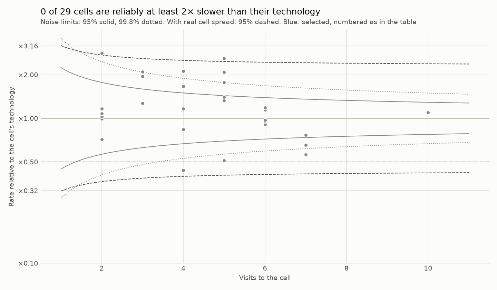
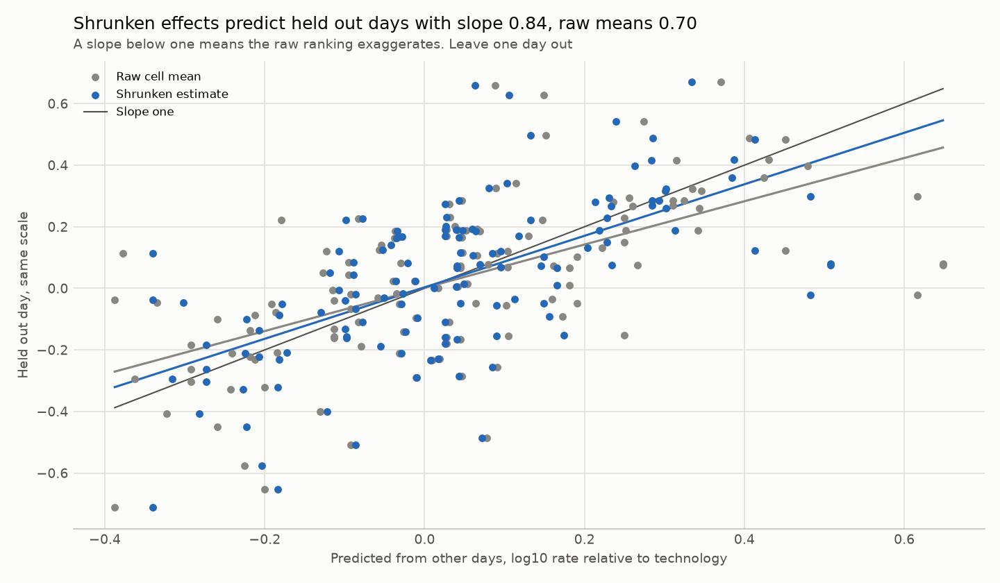

# Cell study: Raca Irish LTE dataset 2017 and 2018, operator B, car

Snapshot `snap_4f205268baa37e77`, file_download sessions, mobility car. Cell identity: proxy: technology family, site coordinates and local number. Method `cell_study_v1`, protocol `docs/TECHNICAL_REPORT.md`. Rates are delivered application rates, not capacity, and no cause is assessed.

## Does a cell keep its rate across days?

210 visits on 88 cells from 12 sessions over 5 days. 132 visits on 29 cells meet the same cell on another day. Leave one day out errors on log10 rate: same cell 0.162, same technology 0.204. Skill against technology 20.8%, permutation null mean -16.5%, p = 0.001. Decision by the frozen rule: replicates beyond technology.

Skill by held out day: 2017-12-14 39.8% (20 visits), 2018-01-16 32.5% (19 visits), 2018-01-17 13.5% (20 visits), 2018-01-18 5.7% (50 visits), 2018-01-19 30.7% (23 visits). The same cell beats its technology on 5 of 5 held out days.

Sensitivity: leaving one session out instead of one day gives 24.1% (p = 0.001), and requiring 20 samples per visit gives 19.4% (p = 0.001).

## Which cells are reliably slow for their technology?

29 cells seen on two or more days. A cell effect is the mean of its visits' log10 rate minus their technology mean. Within cell variance 0.0320, between cell variance 0.0338. Mean reliability 0.80, and 20.7% of cells fall below 0.7. 0 cells are selected as at least 2× slower than their technology at a 10% false discovery limit (expected false selections 0.00). The nonparametric prior selects 0.

| Cell | Technology | Days | Visits | Raw rate factor | Reliability | Shrunken factor | Probability at least 2× slower | Rank, 90% interval | Selected |
| --- | --- | ---: | ---: | ---: | ---: | ---: | ---: | --- | --- |
| LTE:-8.493461,51.894813:2 | LTE | 3 | 4 | ×0.44 | 0.81 | ×0.51 | 0.45 | 1 to 5 | no |
| LTE:-8.469896,51.914353:2 | LTE | 4 | 5 | ×0.51 | 0.84 | ×0.57 | 0.23 | 1 to 6 | no |
| LTE:-8.487001,51.89774:3 | LTE | 4 | 7 | ×0.56 | 0.88 | ×0.60 | 0.11 | 1 to 6 | no |
| LTE:-9.549395,51.746134:2 | LTE | 5 | 7 | ×0.65 | 0.88 | ×0.69 | 0.01 | 2 to 9 | no |
| LTE:-8.483589,51.894878:3 | LTE | 4 | 7 | ×0.77 | 0.88 | ×0.79 | 0.00 | 3 to 12 | no |
| LTE:-8.480989,51.893828:2 | LTE | 2 | 2 | ×0.71 | 0.68 | ×0.79 | 0.03 | 2 to 17 | no |
| LTE:-8.444176,51.916235:1 | LTE | 3 | 4 | ×0.84 | 0.81 | ×0.87 | 0.00 | 4 to 17 | no |
| LTE:-8.378733,51.930323:2 | LTE | 5 | 6 | ×0.91 | 0.86 | ×0.92 | 0.00 | 5 to 17 | no |
| LTE:-8.398621,51.924689:3 | LTE | 5 | 6 | ×0.96 | 0.86 | ×0.96 | 0.00 | 5 to 18 | no |
| LTE:-8.474566,51.902221:2 | LTE | 5 | 6 | ×0.97 | 0.86 | ×0.97 | 0.00 | 6 to 19 | no |

Factors are relative to the technology mean, so ×0.50 is half its typical rate. Ranks count from the slowest. A wide rank interval means the order is not known.

## Verification

| Check | Result | What it shows |
| --- | --- | --- |
| Held out slope, raw cell means | 0.70 (0.48 to 0.88) | Below one means a raw ranking exaggerates differences |
| Held out slope, shrunken estimates | 0.84 (0.59 to 1.00) | Near one means calibrated |
| Held out error, raw, shrunken, technology only | 0.161, 0.154, 0.205 | Lower is better |
| Split sample reliability | 0.79 (0.73 to 0.86) against model mean 0.80 | Two independent estimates agree when close |
| Synthetic recovery, 1000 archives | false discovery 5.9%, power 18.2%, slope 1.02 | The rule keeps its 10% limit when the model is right |

Intervals: 95% cluster bootstrap over cells for slopes, 90% of random splits for reliability. The held out slopes use deviations from technology means estimated on the other days only.

## Limits

What is measured is a cell's area as driven on these routes. Coverage, load, backhaul and configuration are not separated. Time of day is not controlled. Selection controls the expected share of false selections, so a small selected set is a strength, not a gap.
