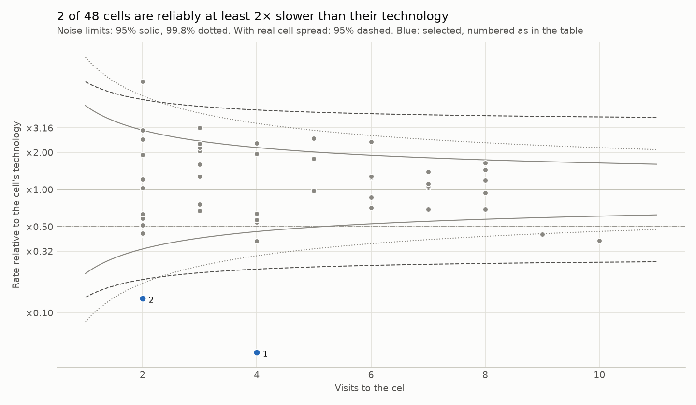
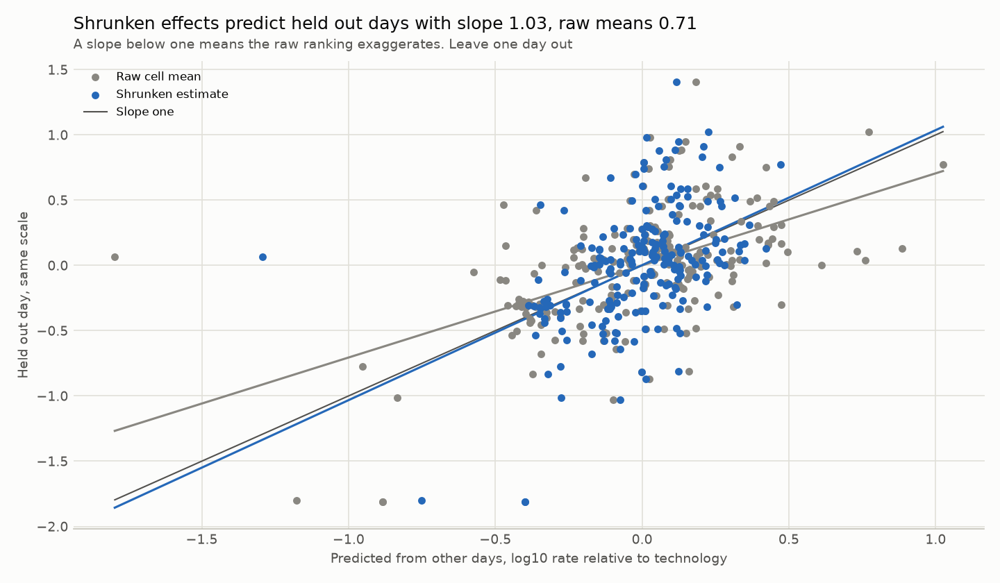

# Cell study: Raca Irish archive, driving, 2019 and 2020

Snapshot `snap_dd48e8cf739fd2be`, file_download sessions, mobility driving. Cell identity: reported serving cell with a known identity basis. Method `cell_study_v1`, protocol `docs/TECHNICAL_REPORT.md`. Rates are delivered application rates, not capacity, and no cause is assessed.

## Does a cell keep its rate across days?

269 visits on 94 cells from 16 sessions over 7 days. 217 visits on 48 cells meet the same cell on another day. Leave one day out errors on log10 rate: same cell 0.285, same technology 0.325. Skill against technology 12.2%, permutation null mean -18.6%, p = 0.001. Decision by the frozen rule: replicates beyond technology.

Skill by held out day: 2019-12-14 7.4% (7 visits), 2019-12-16 20.1% (56 visits), 2019-12-17 37.8% (22 visits), 2020-01-16 35.2% (40 visits), 2020-02-13 -4.7% (41 visits), 2020-02-14 -6.5% (44 visits), 2020-02-27 -10.1% (7 visits). The same cell beats its technology on 4 of 7 held out days. It does worse on 2020-02-13, 2020-02-14 and 2020-02-27.

Sensitivity: leaving one session out instead of one day gives 13.6% (p = 0.001), and requiring 20 samples per visit gives 14.1% (p = 0.001).

## Which cells are reliably slow for their technology?

48 cells seen on two or more days. A cell effect is the mean of its visits' log10 rate minus their technology mean. Within cell variance 0.1209, between cell variance 0.0783. Mean reliability 0.71, and 43.8% of cells fall below 0.7. 2 cells are selected as at least 2× slower than their technology at a 10% false discovery limit (expected false selections 0.14). The nonparametric prior selects 5.

| Cell | Technology | Days | Visits | Raw rate factor | Reliability | Shrunken factor | Probability at least 2× slower | Rank, 90% interval | Selected |
| --- | --- | ---: | ---: | ---: | ---: | ---: | ---: | --- | --- |
| 87198210 | LTE | 3 | 4 | ×0.05 | 0.72 | ×0.11 | 1.00 | 1 to 1 | yes |
| 11127051 | 5G | 2 | 2 | ×0.13 | 0.56 | ×0.32 | 0.86 | 2 to 11 | yes |
| 11016973 | 5G | 7 | 10 | ×0.38 | 0.87 | ×0.44 | 0.72 | 2 to 11 | no |
| 11016972 | 5G | 6 | 9 | ×0.43 | 0.85 | ×0.49 | 0.53 | 3 to 14 | no |
| 10945804 | 5G | 3 | 4 | ×0.38 | 0.72 | ×0.50 | 0.50 | 2 to 18 | no |
| 11113741 | 5G | 2 | 2 | ×0.43 | 0.56 | ×0.62 | 0.30 | 3 to 30 | no |
| 11119116 | 5G | 2 | 2 | ×0.44 | 0.56 | ×0.63 | 0.29 | 3 to 31 | no |
| 10944781 | 5G | 4 | 4 | ×0.54 | 0.72 | ×0.64 | 0.23 | 3 to 27 | no |
| 11112972 | 5G | 3 | 4 | ×0.57 | 0.72 | ×0.66 | 0.20 | 4 to 28 | no |
| 844095 | 3G | 2 | 2 | ×0.51 | 0.56 | ×0.69 | 0.23 | 3 to 33 | no |

Factors are relative to the technology mean, so ×0.50 is half its typical rate. Ranks count from the slowest. A wide rank interval means the order is not known.

## Verification

| Check | Result | What it shows |
| --- | --- | --- |
| Held out slope, raw cell means | 0.71 (0.51 to 0.79) | Below one means a raw ranking exaggerates differences |
| Held out slope, shrunken estimates | 1.03 (0.78 to 1.18) | Near one means calibrated |
| Held out error, raw, shrunken, technology only | 0.298, 0.292, 0.324 | Lower is better |
| Split sample reliability | 0.74 (0.67 to 0.80) against model mean 0.71 | Two independent estimates agree when close |
| Synthetic recovery, 1000 archives | false discovery 8.1%, power 20.2%, slope 1.04 | The rule keeps its 10% limit when the model is right |

Intervals: 95% cluster bootstrap over cells for slopes, 90% of random splits for reliability. The held out slopes use deviations from technology means estimated on the other days only.

## Limits

What is measured is a cell's area as driven on these routes. Coverage, load, backhaul and configuration are not separated. Time of day is not controlled. Selection controls the expected share of false selections, so a small selected set is a strength, not a gap.
