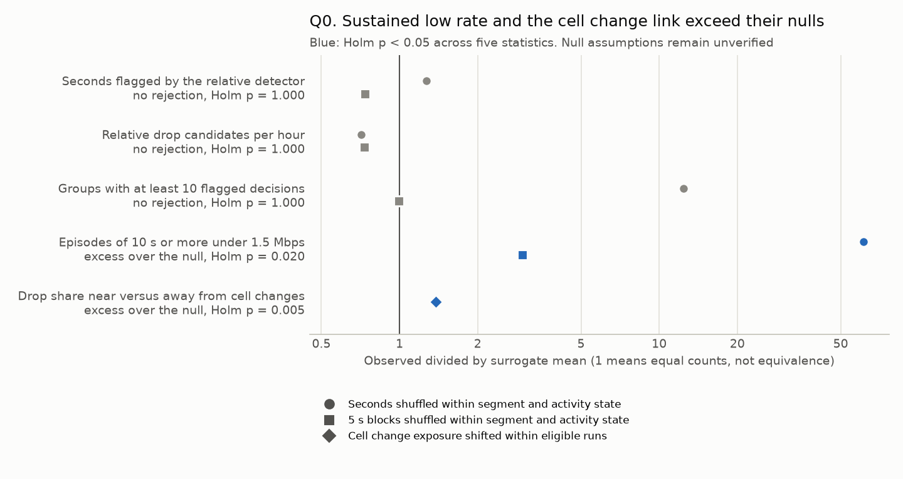
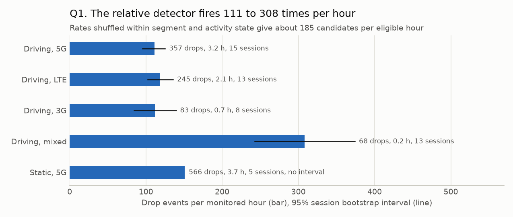
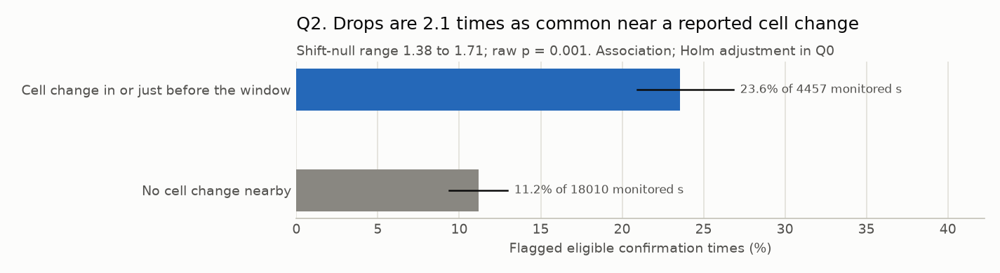
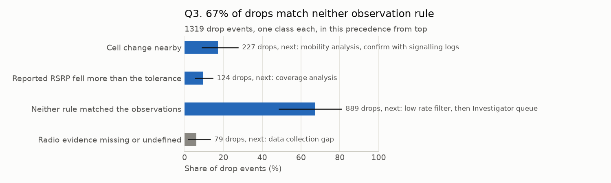
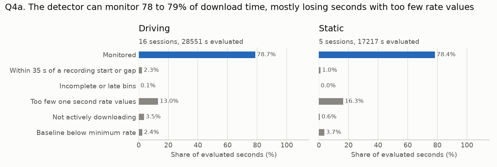
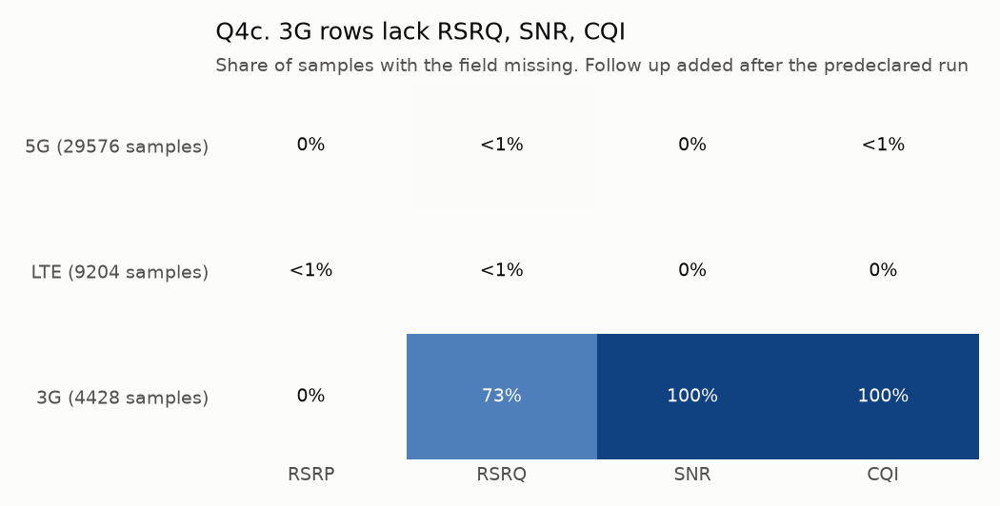
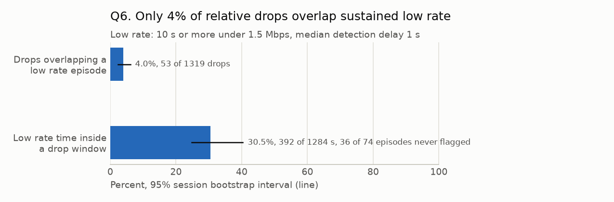

# Population analytics report

Snapshot `snap_dd48e8cf739fd2be`, 21 file download sessions, 1319 drop events from the frozen detector. Plan and limits: `docs/TECHNICAL_REPORT.md`. Intervals resample whole sessions. Descriptive only. These are detector candidates, not independently confirmed network faults. Exposure counts eligible one second confirmation times, not continuous user time.

## Summary

**What this archive shows, each result checked against chance or on held out days.** Technology and mobility rates below are descriptive. This reused archive is exploratory.

- **Slow cells stay slow across days.** Predicting a held out day's visits from the same cell's other days has 12.2% lower error than predicting from the technology (permutation p = 0.001, 217 visits, 7 days). The same cell beats its technology on 4 of 7 held out days. It does worse on 2020-02-13, 2020-02-14 and 2020-02-27. The 10 slowest of 48 cells seen on two or more days hold 22.7% of the samples under 1.5 Mbps. Next step: coverage, load and backhaul data for those cells (Q7).
- **Low rate time comes in stretches.** 74 episodes of 10 s or more under 1.5 Mbps, against 1.2 with seconds shuffled and 24.8 with 5 s blocks shuffled within each segment and activity state (Holm p = 0.020). Throughput is autocorrelated, so this shows persistence, not a cause. Driving on 3G spends 28% (19 to 36) of eligible time under 1.5 Mbps, driving on 5G 3% (2 to 4). Next step: coverage and delivered rate measurements for the worst group.
- **Flagged windows align with cell change exposure.** Flagged windows are 2.1 times as common when a reported cell change occurs in the 10 s before confirmation, against 1.38 to 1.71 when the exposure is shifted within eligible runs (Holm p = 0.005). The change can fall inside the event window, so its order relative to the drop is not established, and technology and route confounding are not adjusted. Next step: signalling logs.
- **Relative detector counts: no rejection.** It fires 132 times per eligible detector hour, against 185 with seconds shuffled and 181 with 5 s blocks shuffled (Holm p = 1.000). Shuffled rates trigger more candidates than the real series, so the count itself is no evidence of structure. Non-rejection does not prove noise either. Against sustained low rate, 4.0% of drops overlap it, and flags are 4.32 times as common inside it as outside (chance placement p = 0.001). Alerts concentrate on sustained low rate beyond chance placement. Candidates remain triage input.
- **Data collection gaps limit diagnosis.** The detector can monitor 78 to 79% of download time. 3G rows lack RSRQ, SNR, CQI, so radio rules cannot be assessed there.
- **Investigation queue.** 19 low rate episodes map to 18 drops queued for the Investigator.

## Q0. Conditional surrogate sensitivity checks

Null models: 199 draws for each rate null and 1000 circular shifts of cell change exposure within contiguous eligible decision runs. Rate values move only within one segment and activity state. Segments end at gaps above 3 s, so a missing bin inside a segment is timing jitter, and missing bins keep their positions. The 5 s null moves blocks of five consecutive valid values. In the median draw the seconds null moved 99.9% of valid bins by a median of 616 s and the block null 99.3% by 619 s. Detector p values take the larger of the two rate nulls, and Holm adjusts all five statistics at alpha = 0.05. The smallest attainable Holm p is 0.025 for a rate statistic and 0.005 for the cell change link.

Rejection under a rate null shows that values are ordered in time within a stratum, which autocorrelated throughput is expected to show. It is not a cause or evidence of detector validity. Non-rejection is not evidence of noise. Null quantiles are surrogate ranges, not confidence intervals. Raw draws, exceedance counts and displacement per draw are in population_summary.json. The null design was repaired after an earlier run of this archive, which is recorded in docs/TECHNICAL_REPORT.md.

| Pattern | Observed | Null mean | Raw p per null | Holm p | Verdict |
| --- | ---: | --- | --- | ---: | --- |
| Seconds flagged by the relative detector | 0.149 | seconds 0.117, 5 s blocks 0.203 | seconds 0.005, 5 s blocks 1.000 | 1.000 | no rejection |
| Relative drop candidates per hour | 132 | seconds 185, 5 s blocks 181 | seconds 1.000, 5 s blocks 1.000 | 1.000 | no rejection |
| Groups with at least 10 flagged decisions | 119 | seconds 9.56, 5 s blocks 120 | seconds 0.005, 5 s blocks 0.545 | 1.000 | no rejection |
| Episodes of 10 s or more under 1.5 Mbps | 74 | seconds 1.21, 5 s blocks 24.8 | seconds 0.005, 5 s blocks 0.005 | 0.020 | excess over the null |
| Drop share near versus away from cell changes | 2.11 | shift 1.53 | shift 0.001 | 0.005 | excess over the null |

## Q1. How often does the relative detector fire?

Across 10.0 eligible decision hours the detector groups 132 candidate drops per hour, about one every 27 s, so follow up work needs ranking (Q3). The highest measured rate is driving mixed, 307.9 drops per monitored hour, and the lowest is driving 5G, 111.1. Compare technologies within one mobility group and mobility within one technology, because the groups are not balanced.

| Mobility | Technology | Sessions | Candidates | Eligible decision hours | Candidates per hour | 95% interval |
| --- | --- | ---: | ---: | ---: | ---: | --- |
| driving | 5G | 15 | 357 | 3.21 | 111.1 | 95.4 to 125.1 |
| driving | LTE | 13 | 245 | 2.07 | 118.6 | 102.5 to 135.7 |
| driving | 3G | 8 | 83 | 0.74 | 112.0 | 84.5 to 139.5 |
| driving | mixed | 13 | 68 | 0.22 | 307.9 | 242.9 to 374.2 |
| static | 5G | 5 | 566 | 3.75 | 151.0 | no interval, 5 sessions |

Use: these rates describe detector activity. Diagnostic validity needs independent labels; Q0 tests surrogate sensitivity. The marginal intervals do not test paired differences between groups, and the small archive does not establish a fleet ranking.

## Q2. Are drops associated with cell changes?

Transition proximity is relative to confirmation time: `[-10000, 0)` ms, start included and end excluded. The outcome is a flagged detector decision, not occupancy of a grouped drop event.

In driving sessions, eligible confirmation times with a reported transition in the event window or its preceding 5 s were flagged 23.6% of the time (20.9 to 26.8), against 11.2% otherwise (9.4 to 12.9). Ratio 2.1 (1.9 to 2.4).

| Group | Eligible confirmation times | Flagged share | 95% interval |
| --- | ---: | ---: | --- |
| Transition in or just before event window | 4457 | 23.6% | 20.9 to 26.8 |
| No cell change nearby | 18010 | 11.2% | 9.4 to 12.9 |

Use: a ratio clearly above one justifies a mobility analysis track with signalling logs. It is an association: a reported transition is not a confirmed handover, and the overlapping windows do not establish the order or cause of the changes.

## Q3. Which observation rules match candidate drops?

889 of 1319 drops (67.4%) match neither the nearby-transition nor the RSRP-fall rule. The low rate queue filter is applied below. 79 cannot be assessed because radio evidence is missing or undefined.

| Class, in precedence order | Drops | Share | 95% interval | Next step |
| --- | ---: | ---: | --- | --- |
| Cell change nearby | 227 | 17.2% | 9.1 to 27.5 | mobility analysis, confirm with signalling logs |
| Reported RSRP fell more than the tolerance | 124 | 9.4% | 5.5 to 14.6 | coverage analysis |
| Neither rule matched the observations | 889 | 67.4% | 48.7 to 80.9 | low rate filter, then Investigator queue |
| Radio evidence missing or undefined | 79 | 6.0% | 2.0 to 13.2 | data collection gap |

Not assessable reasons: rsrp_undefined_outside_lte_and_5g 79. Cell change drops where RSRP also fell: 83.

Use: route rule matches for specialist follow up. They do not explain physical cause. Of 889 drops that match neither rule, 26 touch a sustained stretch under 1.5 Mbps (Q5). The queue assigns 19 low rate episodes to 18 distinct candidates. Each episode selects its earliest overlapping unexplained candidate; duplicate event IDs are dispatched once, most severe episode first, through `celltrace investigate-queue --queue <private>/investigation_queue.json`. These are queued proposals, not completed investigations. Other relative drops remain in the audit; absence of this low rate proxy does not establish absence of user impact.

## Q4. What does missing data hide?

| Mobility | Evaluated seconds | Monitored | Within 35 s of a recording start or gap | Incomplete or late bins | Too few one second rate values | Not actively downloading | Baseline below minimum rate |
| --- | ---: | ---: | ---: | ---: | ---: | ---: | ---: |
| driving | 28551 | 78.7% | 2.3% | 0.1% | 13.0% | 3.5% | 2.4% |
| static | 17217 | 78.4% | 1.0% | 0.0% | 16.3% | 0.6% | 3.7% |

In this snapshot, the rate is never missing inside a bin that has a sample, so the coverage rejections come from empty bins: 14.9% of one second bins hold no sample while 9.1% hold two or more. This is consistent with irregular timing; audit timestamps and collection behavior before choosing a logging change.

Predeclared Q4b. Missing shares in event windows at flagged and other eligible confirmation times. These are window-weighted sample occurrences: overlapping windows count a sample more than once. Technology mix contributes to this descriptive comparison.

| Field | Missing in flagged windows | Missing in other windows | Difference, 95% interval |
| --- | ---: | ---: | --- |
| RSRQ | 3.7% | 5.8% | -5.0 to 0.0 |
| SNR | 6.3% | 8.1% | -5.2 to 1.2 |
| CQI | 6.3% | 8.1% | -5.2 to 1.2 |

Q4c, a follow up added after the predeclared run. Missing share per technology over all file download samples.

| Technology | Samples | RSRP | RSRQ | SNR | CQI |
| --- | ---: | ---: | ---: | ---: | ---: |
| 5G | 29576 | 0.0% | 0.5% | 0.0% | 0.0% |
| LTE | 9204 | 0.0% | 0.0% | 0.0% | 0.0% |
| 3G | 4428 | 0.0% | 73.4% | 100.0% | 100.0% |

Data finding: on 3G rows SNR is missing in 100.0%, CQI in 100.0% and RSRQ in 73.4% of samples, yet RSRP is missing in only 0.0%. RSRP is an LTE and NR measurement; its meaning on these 3G rows is undocumented. The shared applicability rule preserves populated values but rejects them as serving-radio RSRP evidence. Field presence in this table does not imply measurement validity.

Use: missingness is strongly associated with technology in this archive. Do not assume it is random or impute undocumented measurements. Complete-case filtering can change technology mix. The detector cannot flag ineligible times; raw samples there may still support other analyses. Audit sampling cadence and technology-specific collection support.

## Q5. How often is the delivered rate below fixed thresholds?

Rate-only proxies use 1.5 and 5 Mbps, borrowed from historical Opensignal throughput thresholds. Its full Consistent Quality metric also uses latency, jitter and loss; this archive cannot compute it. Below 0.1 Mbps is a project near zero rate threshold, not an observed playback stall. Each eligible decision second is judged by its trailing 5 second median, with the detector's coverage/activity rules and no baseline. Across all sessions 6.1% of eligible decision seconds have a trailing median below 1.5 Mbps (4.4 to 8.5) and 2.0% are below 0.1 Mbps.

| Mobility | Technology | Sessions | Observed hours | Under 0.1 Mbps | Under 1.5 Mbps | Under 5 Mbps |
| --- | --- | ---: | ---: | --- | --- | --- |
| driving | 5G | 15 | 3.54 | 0.9% (0.6 to 1.3) | 2.6% (1.7 to 3.7) | 8.4% (6.2 to 10.8) |
| driving | LTE | 13 | 2.26 | 0.7% (0.3 to 1.1) | 4.5% (2.8 to 7.0) | 28.9% (22.5 to 37.9) |
| driving | 3G | 8 | 0.94 | 8.9% (2.2 to 17.2) | 27.6% (19.0 to 35.5) | 72.6% (61.4 to 82.0) |
| driving | mixed | 14 | 0.24 | 5.7% (2.8 to 9.0) | 13.5% (9.5 to 18.1) | 44.7% (40.2 to 50.8) |
| static | 5G | 5 | 4.28 | 1.8% (no interval, 5 sessions) | 4.8% (no interval, 5 sessions) | 6.7% (no interval, 5 sessions) |
| all | all | 21 | 11.25 | 2.0% (1.2 to 3.0) | 6.1% (4.4 to 8.5) | 18.0% (13.0 to 25.0) |

Sustained episodes need at least 10 consecutive seconds with a trailing median below a level. This is a project persistence filter, not SRE multiwindow burn-rate alerting. An episode represents [first decision minus 1 s, last decision); its ten-second qualification is available only at the tenth decision. This is a retrospective description. Sensitivity at other durations:

| Level | Episodes, 5 s or more | Episodes, 10 s or more | Episodes, 30 s or more | Median length, primary |
| --- | ---: | ---: | ---: | ---: |
| Near zero delivered rate, under 0.1 Mbps | 55 | 15 | 1 | 13.0 s |
| Delivered rate under 1.5 Mbps | 155 | 74 | 6 | 15.0 s |
| Delivered rate under 5 Mbps | 418 | 214 | 41 | 16.0 s |

Limits: the kbps unit of the archive is inferred from magnitude, and absolute levels depend on it while relative drops do not. The archive has almost no latency under load, which Apple's networkQuality and the IETF Responsiveness draft treat as a core symptom, so that experience cannot be measured here and is a data collection gap.

## Q6. How often do relative drops coincide with sustained low rate?

Overlap between two rate rules, not detector accuracy. Low rate episode: Delivered rate under 1.5 Mbps, sustained 10 s or more.

| Measure | Value | 95% interval | Counts |
| --- | ---: | --- | --- |
| Drops overlapping a low rate episode | 4.0% | 2.4 to 6.1 | 53 of 1319 drops |
| Low rate time inside a drop window | 30.5% | 24.8 to 40.4 | 392 of 1284 s |
| Low rate episodes touched by any drop | 51.4% | 41.5 to 63.5 | 38 of 74 episodes |

Median detection delay 1.0 s, 90th percentile 6.3 s (linear interpolation), from the start of an episode's decision intervals to the first overlapping confirmation. 36 low rate episodes never overlap a relative drop. The overlap count alone does not establish whether poor initial rate, insufficient reference coverage or another detector condition explains each miss. Their next step is a separate low rate investigation with demand, coverage and transport checks.

Sensitivity across levels, same 10 s duration:

| Low rate level | Drops overlapping | Time inside drop windows | Episodes touched |
| --- | ---: | ---: | ---: |
| Near zero delivered rate, under 0.1 Mbps | 0.2% | 2.9% | 2 of 15 |
| Delivered rate under 1.5 Mbps | 4.0% | 30.5% | 38 of 74 |
| Delivered rate under 5 Mbps | 13.9% | 28.7% | 124 of 214 |

These scores measure agreement between two rate rules, not accuracy against independently labeled user harm or physical incidents. Unmatched drops can still matter to higher-rate applications. Time coverage and episode recall have different denominators. The queue is a retrospective cost-control policy; its smaller size does not establish fewer false alarms, successful investigations or better recall.

Q6b, frozen on 12 October 2026 before it was computed: flagged decisions are 4.32 times as common inside sustained low rate episodes as outside them (322 of 524 eligible decisions inside episodes flagged, 5045 of 35438 outside), against 3.11 to 3.82 when the episode indicator is shifted within eligible runs (p = 0.001, 1000 shifts). Alerts concentrate on sustained low rate beyond chance placement. This is its own test, outside the Q0 family.

## Q7. Does a serving cell keep its delivered rate across days?

Frozen on 12 October 2026 before any per cell rate was computed. A visit is one driving session on one serving cell with at least 10 active download samples, valued by its median rate. Each held out day is predicted from the other days only. 269 visits on 94 cells from 16 sessions over 7 days. 217 visits on 48 cells meet the same cell on another day and are scored. Errors are on log10 of the rate, so an error of 0.30 means a factor of 2.

| Prediction from other days | Mean absolute error, log10 | Typical factor |
| --- | ---: | ---: |
| Same cell | 0.285 | 1.93 |
| Same technology | 0.325 | 2.11 |
| All visits | 0.407 | 2.55 |

Skill of the cell against its technology: 12.2%. With cell labels permuted within day and technology, skill averages -18.6% (95% of 999 permutations between -27.6% and -9.4%), p = 0.001. Decision by the frozen rule: the cell rate replicates beyond technology.

| Held out day | Visits | Error, same cell | Error, same technology | Skill |
| --- | ---: | ---: | ---: | ---: |
| 2019-12-14 | 7 | 0.281 | 0.304 | 7.4% |
| 2019-12-16 | 56 | 0.266 | 0.333 | 20.1% |
| 2019-12-17 | 22 | 0.178 | 0.286 | 37.8% |
| 2020-01-16 | 40 | 0.194 | 0.300 | 35.2% |
| 2020-02-13 | 41 | 0.346 | 0.330 | -4.7% |
| 2020-02-14 | 44 | 0.360 | 0.338 | -6.5% |
| 2020-02-27 | 7 | 0.467 | 0.424 | -10.1% |

The same cell beats its technology on 4 of 7 held out days. It does worse on 2020-02-13, 2020-02-14 and 2020-02-27. Cells can change over weeks, and this archive cannot tell why, so a ranking needs refreshing.

Sensitivity, not decisions: with at least 20 samples per visit the skill is 14.1% (p = 0.001, 198 visits), and leaving one session out instead of one day it is 13.6% (p = 0.001). Rank correlation between the cell prediction and the held out rate: 5G 0.61 (124 visits), LTE 0.18 (86 visits). Share of samples under 1.5 Mbps, mean absolute error: same cell 0.074, same technology 0.080.

Slowest of the 48 cells seen on two or more days. The ranking uses every day, so it is descriptive. The test above is what makes it worth acting on.

| Cell | Technology | Days | Visits | Samples | Median visit rate (Mbps) | Visit medians, lowest to highest (Mbps) | Share under 1.5 Mbps | Median reported RSRP (dBm) |
| --- | --- | ---: | ---: | ---: | ---: | --- | ---: | ---: |
| 87198210 | LTE | 3 | 4 | 103 | 0.0 | 0.0 to 7.2 | 82.5% | -77 |
| 844095 | 3G | 2 | 2 | 613 | 0.8 | 0.3 to 1.2 | 56.6% | n/a |
| 19737028 | 3G | 2 | 2 | 105 | 0.8 | 0.5 to 1.0 | 82.9% | n/a |
| 19767337 | 3G | 3 | 3 | 995 | 2.5 | 1.7 to 3.8 | 28.3% | n/a |
| 11127051 | 5G | 2 | 2 | 36 | 2.8 | 2.3 to 3.4 | 30.6% | -101 |
| 11016963 | LTE | 4 | 4 | 417 | 4.1 | 1.0 to 15.2 | 27.3% | -97 |
| 87812611 | LTE | 2 | 3 | 462 | 4.2 | 4.1 to 5.9 | 20.6% | -88 |
| 124546049 | LTE | 2 | 2 | 116 | 4.2 | 2.6 to 5.7 | 18.1% | -84 |
| 94801410 | LTE | 5 | 7 | 495 | 5.2 | 1.4 to 10.9 | 18.8% | -73 |
| 70839810 | LTE | 6 | 7 | 205 | 5.7 | 2.6 to 19.1 | 21.5% | -99 |

The range and RSRP columns were added after the frozen run and are descriptive. RSRP is undefined on 3G rows. Good signal with a low rate does not establish congestion, and weak signal does not establish a coverage hole.

These 10 cells hold 22.7% of the under 1.5 Mbps samples in all visits and 13.4% of all visit samples.

Use: a cell that stays slow across days is a candidate for a coverage, load or backhaul check, which this archive cannot separate. What is measured is the cell's area as driven on these routes. Time of day is not controlled, and one operator's cells in one city do not make a network wide ranking.
